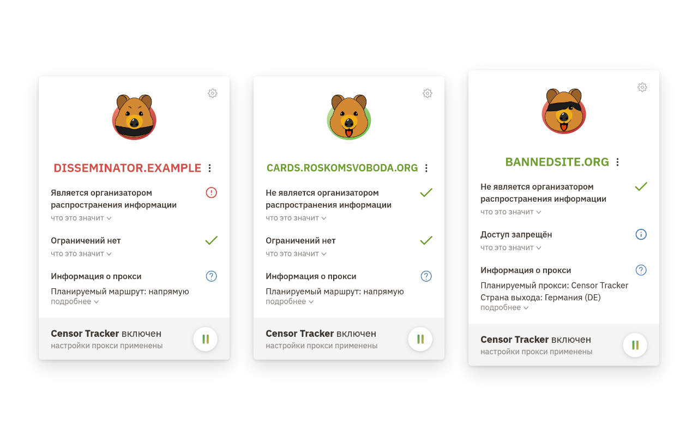

  

<a href="README.md">English</a> | <b>Русский</b>

 <b><a href="https://censortracker.org/">Censor Tracker</a></b> (<a href="https://storage.googleapis.com/amnezia/censortracker">зеркало</a>) — браузерное расширение для <strong>обхода блокировок</strong>. 

Оно поддерживает собственные прокси и локальный SOCKS5-прокси <a href="https://amnezia.org/premium">Amnezia Premium</a> (<a href="https://storage.googleapis.com/amnezia/amnezia.org?m-path=/premium">зеркало</a>).

  
  

  

Возможности
===========

Censor Tracker — расширение для обхода интернет-ограничений. Оно помогает открывать сайты, подверженные ограничениям, а также предупреждает о сайтах, которые передают данные государственным органам. Работает в России, Украине, Беларуси, Казахстане, Кыргызстане, Узбекистане, Азербайджане, Грузии, Турции и других странах.

С расширением вы можете:

- Обходить ограничения, в том числе блокировки через DPI
- Скрывать свой IP от посещаемых сайтов с помощью встроенных прокси-серверов
- Подключать собственные прокси и подписки на списки прокси
- Использовать расширение вместе с приложением [Amnezia VPN](https://amnezia.org/premium) ([зеркало](https://storage.googleapis.com/amnezia/amnezia.org?m-path=/premium)) (Premium) с помощью опции "Amnezia Local Proxy"
- Управлять своими списками сайтов, которые нужно открывать через прокси
- Узнавать о сайтах, которые передают ваши данные третьим лицам (для России)
- Открывать сайты `*.onion` и `*.i2p` без дополнительных программ

Censor Tracker не собирает историю браузера и не отправляет данные о сайтах, которые вы открываете. В нём нет аналитики и трекеров. Сетевые функции включаются только после вашего согласия. Подробнее — в [политике конфиденциальности](https://github.com/censortracker/censortracker/wiki/Privacy-Policy).

Если что-то не работает, попробуйте переустановить расширение или напишите нам в поддержку Telegram: [@censortracker_support_bot](https://t.me/censortracker_support_bot) или на почту support@censortracker.org

Разрешения
==========

Censor Tracker запрашивает следующие разрешения:

- `alarms` — периодические задачи: синхронизация базы и обновление списка прокси-серверов.
- `activeTab` — анализ текущей страницы, когда пользователь запрашивает связанные домены.
- `management` — поиск конфликтов разрешений (например, с другими расширениями).
- `notifications` — показ уведомлений.
- `proxy` — настройка встроенных и собственных маршрутов через прокси.
- `storage` — хранение настроек пользователя.
- `unlimitedStorage` — хранение базы заблокированных сайтов (из-за её большого размера).
- `tabs` (Firefox) — чтение URL вкладок и анализ страниц.
- `scripting` (Chromium) — чтение доменов ресурсов текущей страницы по запросу.
- `webNavigation` (Chromium) — отслеживание навигации и ошибок подключения к прокси.
- `webRequest` — обработка событий запросов и аутентификация на прокси.
- `webRequestAuthProvider` (Chromium) и `webRequestBlocking` (Firefox) — передача учётных данных прокси.
- `<all_urls>` — проксирование сайтов, загрузка данных сервисов, определение страны и анализ страниц.

Требования
==========

Стандартные сборки поддерживают следующие минимальные версии браузеров:

- Mozilla Firefox 91.1.0 или новее
- Chromium (Google Chrome, Brave, Edge, Opera и др.) 108 или новее

Разработка
==========

Используйте Node.js 24.15.0 или новее и входящую в него версию npm.

Также может пригодиться:

- [nvm](https://github.com/nvm-sh/nvm)
- [Nix](https://nixos.org/): `nix develop` (или `direnv allow`) даёт Node.js и
  `chromium-latest`, `chromium-min`, `firefox-latest`, `firefox-min` для браузерных тестов

Сначала установите зависимости:

    npm ci

Сборка для Chrome:

    npm run build:chrome         # .output/chrome-mv3-dev/

Сборка для Firefox:

    npm run build:firefox        # .output/firefox-mv2-dev/

Для production-сборок добавьте суффикс `:prod`. Тесты и проверки линтером:

    npm test
    npm run lint

**Решение проблем**: если сборка через `npm` завершается ошибкой, убедитесь, что ваш shell поддерживает
переменные окружения для отдельной команды (например, `CT_FIREFOX_MODERN=1 npm run build:firefox:prod`).

Лицензия
========

Censor Tracker распространяется под лицензией MIT. Подробнее см. [LICENSE].

[LICENSE]: https://github.com/censortracker/censortracker/blob/master/LICENSE
